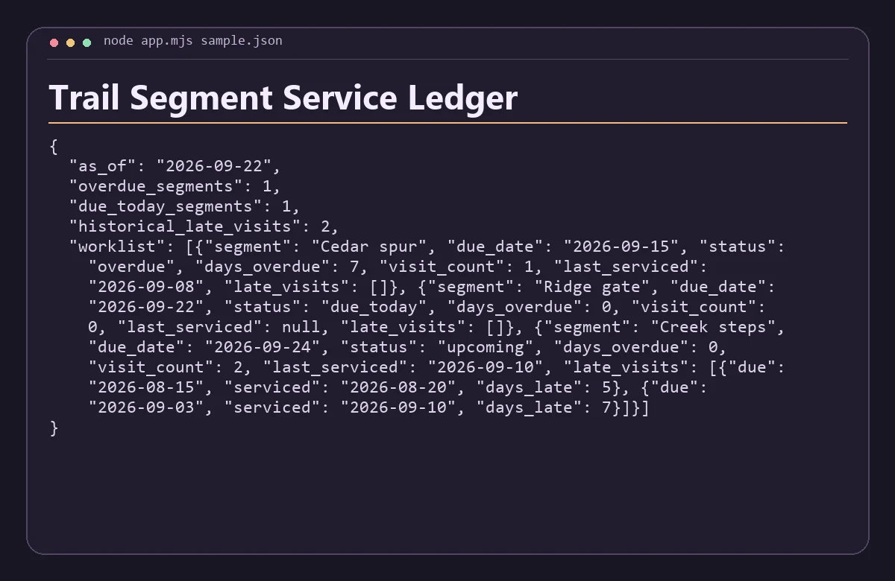

# Trail Segment Service Ledger

Turn a trail crew's completed visits and chosen service cadence into a follow-up worklist, with overdue segments and past scheduling slips.



## Run

Install Node.js 22 or newer. Run these commands from the repository root.

```sh
node app.mjs sample.json
```

Replace `sample.json` with a JSON file following the same structure. The app prints a JSON report to standard output.

Use YYYY-MM-DD calendar dates and your own planning interval for every segment. The interval begins at the tracking date and restarts after each distinct completed visit. Duplicate visits on the same date count once. The worklist is ordered by the next due date and the report measures timing against the supplied cadence.

## Verify

Run `python check.py` with Python 3.11 or newer after the build step when applicable. The check verifies the bundled scenario and confirms that an invalid input returns an error.
